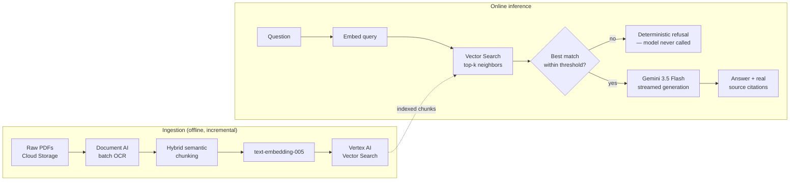

# RAG Cardiology Assistant — Client Deployment Simulation

> This repo is a **Terraform-driven client-deployment simulation**, built on top of [`RAG_Cardiology_Assistant`](https://github.com/Manel-Green/RAG_Cardiology_Assistant) — the original project, where the RAG application itself (retrieval, generation, conversation memory, evaluation) was built and documented in depth. This repo takes that already-working application and deploys it, from scratch, to a brand-new GCP project via Terraform — simulating handing a finished AI solution to a new client and integrating it on their own infrastructure. See "Infrastructure as Code" below for what that involved.

A retrieval-augmented Q&A assistant for cardiology research papers — built as a portfolio project to practice real production RAG engineering, not a tutorial walkthrough. Every answer is grounded in retrieved excerpts from an indexed corpus of real clinical papers and guidelines, with the exact source paragraph returned alongside the answer.

## Why this exists

Doctors asking a clinical question need an answer they can trust, which means two things a generic chatbot doesn't give you: the answer has to come *only* from real sources, and it has to say exactly which source. This project is an exercise in building that constraint into the system at the architecture level rather than hoping the prompt holds:

- Retrieval returns the ground-truth chunks; the model is never allowed to self-report what it "used."
- A distance-threshold gate refuses to answer in code, before the model is even called, if nothing in the corpus is actually close enough to the question — not left to the model's judgment.
- Every citation shown to the user is the real chunk that was retrieved and fed to the model, with the real paper title, journal, and a verified DOI link.

## Infrastructure as Code

Every piece of infrastructure here — the storage bucket, Document AI OCR processor, Vertex AI Vector Search index and endpoint, and the Cloud Run service — is defined in Terraform (`terraform/main.tf`), written from scratch with parameterized `variable` blocks (`terraform/variables.tf`), not hardcoded to one project. Real values live in a gitignored `terraform.tfvars`; `terraform.tfvars.example` documents the shape with blank values.

This was built and deployed against a completely separate, newly created GCP project (`manel-rag-cardiology`) and a separate GitHub repo from the original — deliberately simulating handing a finished solution to a new client, not just redeploying into the same environment the code was originally built in.

Deploying to a genuinely clean environment surfaced two real bugs that this kind of clean deployment is supposed to catch:
- The SQLite conversation-history schema was never actually defined in code, only ever created ad hoc — fixed with an explicit `init_db()` call at application startup.
- The frontend's backend URL was hardcoded to `localhost:8080` — fixed to read from a Vite environment variable (`VITE_BACKEND_BASE_URL`), falling back to localhost for local dev.

Terraform-managed resources:
- `google_storage_bucket` — with object versioning enabled, so pipeline data (chunks, embeddings) can't be silently overwritten without a recoverable history
- `google_document_ai_processor`
- `google_vertex_ai_index` / `google_vertex_ai_index_endpoint`
- `google_cloud_run_v2_service` / `google_cloud_run_v2_service_iam_member`

**Deployment:** the Cloud Run service is defined and managed via Terraform; the container itself is built and deployed via `gcloud run deploy --source` for this simulation. (A Cloud Build push-to-deploy trigger, like the original project has, wasn't part of this exercise's scope.)

## Architecture



**Backend:** FastAPI on Cloud Run, streams the answer token-by-token via a `text/plain` chunked response (a `⁣⁣SOURCES⁣⁣` delimiter separates the streamed answer from a trailing JSON block of source citations).

**Frontend:** React (Vite), reads the stream with the Fetch API's `ReadableStream`, and paces the reveal client-side with a timed typewriter effect — decoupled from however fast the network actually delivers chunks, so the UI reads consistently regardless of connection speed.

## Engineering decisions worth knowing about

**Deterministic refusal, not prompted refusal.** The system prompt instructs the model to refuse when it lacks information, but that's a backstop, not the mechanism — the real gate is in code: if the closest retrieved chunk is further than `DISTANCE_THRESHOLD` (0.35), the model is never called at all.

**SDK migration, not just a model swap.** Generation originally used the `vertexai.generative_models` SDK. Migrating to `gemini-3.5-flash` ahead of `gemini-2.5-flash`'s deprecation surfaced a subtler problem: that SDK's `vertexai.init(location="global")` call shares global state with the separate Vector Search client, and silently broke retrieval. Fixed by moving generation onto the newer, independent `google-genai` SDK (`genai.Client(...)`), which doesn't share state with `aiplatform.MatchingEngineIndexEndpoint`.

**Cost-aware index configuration.** Vertex AI Vector Search defaults to `SHARD_SIZE_MEDIUM`, which only runs on `e2-standard-16` (~$0.62/hr). Explicitly set `shard_size="SHARD_SIZE_SMALL"` to run on `e2-standard-2` (~$0.09/hr) instead — correctly sized for a corpus this size.

**Data lineage matters, not just application logic.** Rebuilding this project in a fresh environment surfaced a real gap: the original project's storage bucket had no object versioning, so when its pipeline outputs got silently overwritten at some point, the specific data behind an already-deployed index became unrecoverable. This repo's bucket has versioning enabled from the start — a one-line Terraform fix, but a necessary one for anything meant to be auditable later.

## Corpus

6 cardiology papers and guidelines (chest pain evaluation, SGLT2i cardiovascular outcomes, cryptogenic stroke/AF detection, myocardial viability, contrast-induced nephropathy prevention), indexed incrementally — new papers can be added without reprocessing the existing corpus (see `reindex_new_studies.py`).

## Project structure

```
terraform/
  main.tf                    Infrastructure: bucket, Document AI, Vector Search, Cloud Run
  variables.tf                Parameterized inputs (project_id, region, bucket_name)
  terraform.tfvars.example    Shape of the real (gitignored) tfvars file

src/
  create_processor.py       One-time setup: Document AI OCR processor
  extract_text.py           Step 2a: batch OCR extraction from raw PDFs
  chunk_text.py             Step 2b: hybrid semantic chunking
  build_embeddings.py       Step 3: embed chunks, prep Vector Search input files
  create_index.py           Step 4: create the Vector Search index (Tree-AH)
  deploy_index.py           Step 5: deploy the index to a queryable endpoint
  query_index.py            Step 6: validate retrieval against real test questions
  reindex_new_studies.py    Phase 2: incremental re-indexing for newly added papers
  generate_answer.py        Phase 3: retrieval + generation + streaming + citations
  app.py                    Phase 4: FastAPI backend wrapping generate_answer.py
  db.py                     Conversation history persistence (SQLite)
  validate_embeddings.py    Diagnostic: structural checks on embeddings before indexing
  check_citations.py        Diagnostic: pulls verified title/journal text from indexed chunks

frontend/
  src/App.jsx                React chat UI — streaming answers, citation cards
  src/App.css                Styling

Dockerfile                   Backend container (FastAPI + uvicorn)
```

## Running it locally

Requires a GCP project with Document AI, Vertex AI, and Vector Search enabled, and `gcloud auth application-default login` configured.

```bash
python3 -m venv venv && source venv/bin/activate
pip install -r requirements.txt

# Backend (from src/)
cd src && uvicorn app:app --reload --port 8080

# Frontend (separate terminal, from frontend/)
cd frontend && npm install && npm run dev
```

Set `VITE_BACKEND_BASE_URL` in `frontend/.env` to point at your running backend.

To deploy the infrastructure from scratch against your own GCP project:

```bash
cd terraform
terraform init
terraform plan   # review before applying
terraform apply
```

## Stack

Terraform · Document AI · Vertex AI Vector Search · Vertex AI Embeddings (`text-embedding-005`) · Gemini 3.5 Flash (`google-genai` SDK) · FastAPI · Cloud Run · Cloud Build · React (Vite)
